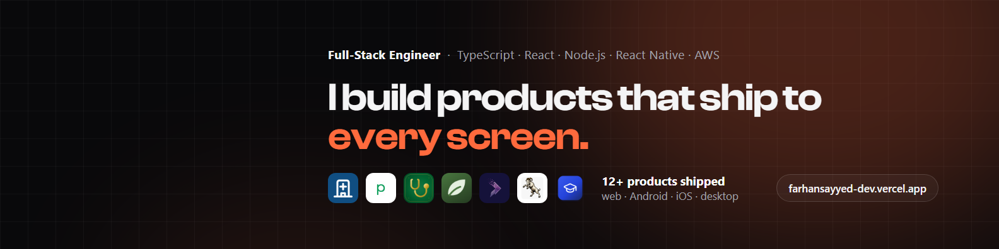

## Hi, I'm Farhan

**Full-stack engineer in Mumbai.** I build multi-tenant SaaS products and ship them to web, Android, iOS and desktop from one TypeScript codebase. 2.5+ years, 12+ products in production.

[Portfolio](https://farhansayyed-dev.vercel.app) · [LinkedIn](https://www.linkedin.com/in/farhan-sayyed-78ab67340) · [Email](mailto:farhan.sayyed.tech@gmail.com)

## Work in production

Most of my day-to-day work is client code in private repositories. These products are live:

| Product | What it is | Result |
| --- | --- | --- |
| [HMS](https://hms.fiveminfotech.com) | Multi-tenant hospital management platform | Yearly billing report cut **98.5%**, from 10.5 s to 152 ms, on 4.5 million records |
| [Plusveda](https://www.plusveda.online) | Pharmacy inventory and point-of-sale SaaS | 182 REST endpoints, one codebase for 4 platforms |
| [AshShifa](https://play.google.com/store/apps/details?id=com.ashshifa.app) | Islamic companion app | Live on Google Play in 176 countries |
| ParentAI | AI learning app for families | Lessons in 7 Indian languages with Google Gemini |

## Open on GitHub

| Repository | What it shows |
| --- | --- |
| [farhansayyed.dev](https://github.com/Farhan8928/farhansayyed.dev) | My portfolio: React, Vite and Tailwind, prerendered to static HTML at build time |
| [Khayyat-Shamsan-Al-Arab](https://github.com/Farhan8928/Khayyat-Shamsan-Al-Arab) | Bilingual English and Arabic website with right-to-left layout |
| [arabian-darbar](https://github.com/Farhan8928/arabian-darbar) | Restaurant website built with React, Vite and Tailwind |
| [ecommerce-website-by-farhansayyed](https://github.com/Farhan8928/ecommerce-website-by-farhansayyed) | Full MERN e-commerce store |
| [Lecture-Scheduling-Module](https://github.com/Farhan8928/Lecture-Scheduling-Module) | MERN scheduling app with admin and instructor roles |

## Stack

- **Frontend:** React, Next.js, React Native, Expo, Redux, Tailwind CSS
- **Backend:** Node.js, Express, NestJS, REST APIs, Socket.IO
- **Data:** MongoDB, PostgreSQL, MySQL, Redis, Prisma
- **Cloud and DevOps:** AWS, Azure, Docker, NGINX, GitHub Actions, CI/CD
- **Certified:** Microsoft Azure Fundamentals (AZ-900), Azure AI Fundamentals (AI-900)

## What I'm looking for

Full-stack, backend or cloud engineering roles in India, the UAE or remote.
The fastest way to reach me is [farhan.sayyed.tech@gmail.com](mailto:farhan.sayyed.tech@gmail.com).
